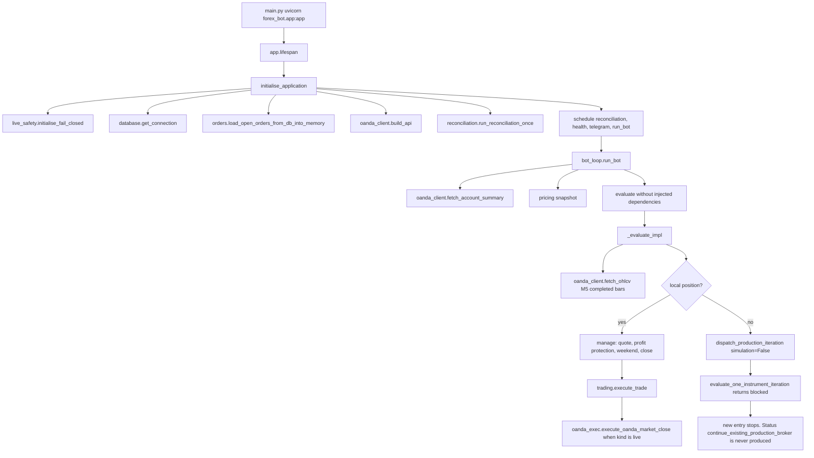

# R.66 Operational architecture

Read-only source trace of the working tree at commit `d080d897945bc44fa37c02caab504ed707146bec`. The tree was already dirty. This audit did not execute `main.py`, import `forex_bot` (importing `forex_bot.config` calls `load_dotenv()`), or contact OANDA.

Scope: the operational startup graph and the modules it reaches for strategy, risk, execution, and persistence. Historical research trees under `data/research/adaptive_ensemble/r2`–`r65` and `forex_bot/research/` were classified by import reachability. They were not read line by line. That limit is stated so this document does not claim a line-by-line audit of all 732 Python files.

`REAL_NETWORK_EXECUTION_NOT_TESTED`. Production trading remains NO-GO.

## Runtime flow

## Startup

| Step | Path | What it does | Side effect if the process were started |
| --- | --- | --- | --- |
| Process entry | `main.py` | Configures logging and runs uvicorn on `forex_bot.app:app`, host `0.0.0.0`, port 8000 | Binds a socket. Not executed in this audit |
| Lifespan | `forex_bot/app.py` `lifespan` | Calls `initialise_application` with production ports | Not executed |
| Safety | `forex_bot/live_safety.py` `initialise_fail_closed` | Loads durable strategy flags. Effective live-order authorisation is set blocked on every process start, including when a stored document says allowed | Writes the safety document |
| Persistence | `database.get_connection` | Opens PostgreSQL | Network to the database |
| Order recovery | `orders.load_open_orders_from_db_into_memory` | Restores order rows into RAM. Positions are not loaded from this call | Reads the database |
| Broker client | `oanda_client.build_api` | Builds the REST client from environment | No order by itself |
| Startup reconcile | `reconciliation.run_reconciliation_once` | Fetches open positions when an API client and account id exist | Broker read |
| Scheduled work | `schedule_trading` | Starts reconciliation, health snapshot, telegram inbound, and `run_bot` | Continuous broker reads and the decision loop |

`run_bot` (`forex_bot/bot_loop.py` around 4402–4429) loops forever: account summary, pricing snapshot, one symbol at a time, portfolio metrics, optional live-window log, `evolve()`, `daily_report()`, then `Config.TRADE_INTERVAL` (60 seconds).

## Component register

Classification evidence is the import and call graph from `main.py` → `app.py` → `bot_loop.py`, plus functions those modules call. "Active" means the function is on that graph and can run when its predicate is true. It does not mean this audit ran it.

| Path | Public surface | Role | OS | Imported by the operational graph | Class |
| --- | --- | --- | --- | --- | --- |
| `main.py` | `__main__` | uvicorn entry | Both | Yes, process entry | Active if started. Not started here |
| `forex_bot/app.py` | `lifespan`, HTTP status routes, `set_mode_*` | Startup, shutdown, status | Both | Yes | Active control plane. `set_mode` changes `Config.TRADING_MODE` in memory. It does not by itself place an order |
| `forex_bot/bot_loop.py` | `run_bot`, `evaluate`, `_evaluate_impl`, `evaluate_one_instrument_iteration`, `production_execution_adapter` | Cycle, management, shared entry decision | Both | Yes | Active cycle. New-entry producer refuses. See decision audit |
| `forex_bot/config.py` | `Config` | Env configuration. Calls `load_dotenv()` at import | Both | Yes | Active. Not imported by this audit |
| `forex_bot/oanda_client.py` | `build_api`, `fetch_ohlcv`, `fetch_account_summary` | Market and account reads | Both | Yes | Active read path. Not called here |
| `forex_bot/oanda_exec.py` | `execute_oanda_market_open`, `execute_oanda_market_close`, classifiers | OrderCreate and PositionClose | Both | Yes | Close is reachable from management of a live position. Open is reachable only from `production_execution_adapter`, which the current producer cannot authorise |
| `forex_bot/execution.py` | `get_execution_mode`, `pre_trade_entry_blocked_reason`, fill paths | Paper vs broker profile and new-entry gate | Both | Yes | Active |
| `forex_bot/live_safety.py` | `initialise_fail_closed`, `live_open_blocked_reason` | Durable strategy flags and live-order auth | Both | Yes | Active. Effective auth starts blocked |
| `forex_bot/strategy_meta.py` | `select_strategy`, `Strategy`, `seq_model` | Strategy name selection | Both | Yes | Called only after the shared decision returns a status the producer never returns, or inside the shared function after a simulation-only gate. Not on the current production entry path |
| `forex_bot/ai_ensemble.py` | `AIEnsemble.vote` | Direction voter | Both | Yes, module import builds `ai` | Same reachability as strategy selection. Default ensemble has zero local voters |
| `forex_bot/rl_agent.py` | `RLAgent.decide` | Tabular gate | Both | Yes | Same. `persisted_ok` starts false, so `decide` returns `UNAVAILABLE` |
| `forex_bot/indicators.py` | `compute_indicators` | MA, ATR, RSI, Bollinger, MACD | Both | Yes | Used by the unreachable entry tail and by paper close pricing when a paper position is managed |
| `forex_bot/shadow/signals.py` | `signal_from_indicators` | Deterministic shadow rules | Both | Shadow package, not the live voter | Research/observation. Not the live direction |
| `forex_bot/trading.py` | `position_sizing`, `execute_trade`, `sl_tp_distance_for_entry` | Sizing, costs, close booking | Both | Yes | `execute_trade` is on the management close path. Sizing is on the unreachable new-entry tail and on the simulation-only shared function |
| `forex_bot/profit_protection.py` | `apply_profit_protection` | Application-managed giveback close | Both | Yes | Active when a local position exists |
| `forex_bot/live_manage.py` | `resolve_broker_manage_price`, `broker_sl_tp_hit` | Broker quote for management | Both | Yes | Active for broker-backed locals. `broker_sl_tp_hit` always returns false |
| `forex_bot/entry_geometry.py` | `resolve_live_entry_geometry` | Bid/ask SL/TP for a new broker order | Both | Yes | Only in the unreachable legacy tail |
| `forex_bot/portfolio_exposure.py` | notional cap, USD-direction guard, `GBP: 1.35` fallback | Book caps | Both | Yes | Used by the unreachable tail and by shared sizing after the simulation gate |
| `forex_bot/execution_risk.py` | `entry_risk_block` | Daily loss, drawdown, exposure cap | Both | Yes | Only after the shared function has already required an isolated simulation context |
| `forex_bot/account_reconciliation.py` | `reconcile_for_entry` | Entry NAV attestation | Both | Shared iteration only | Simulation-context entry gate |
| `forex_bot/reconciliation.py` | `run_reconciliation_once` | Broker vs local positions | Both | Startup and reconciliation loop | Active read. Import of broker positions is on when execution mode is `paper_broker` or `live_broker` |
| `forex_bot/orders.py` | reservation, fill, status | Local order book | Both | Yes | Active recovery and reservation helpers |
| `forex_bot/positions.py` | in-memory `positions` | Local position book | Both | Yes | RAM only. Not reloaded from PostgreSQL by startup recovery |
| `forex_bot/database.py` | trades, orders, exposure helpers | PostgreSQL | Both | Yes | Active if the process starts |
| `forex_bot/session_rules.py` | session, weekend, volatility | Time and ATR filters | Both | Yes | Session/weekend block new entries inside `_evaluate_impl` before the shared call when no position is open. They also drive weekend flatten of an open local position |
| `forex_bot/nn_pred.py` | `compute_nn_pred` | Price hint for a voter payload | Both | Yes | Unreachable production entry tail. Default live mode adds random noise |
| `forex_bot/backtest.py` | `main` | Offline backtest script | Both | Not imported by `app` or `bot_loop` | Offline tool. Not executed |
| `forex_bot/research/learning/` | research learners | Offline research | Both | Not imported by `app` or `bot_loop` | Research-only |
| `forex_bot/v2_shadow/` | observation store | Records M5 bars from the cycle | Both | Called from `_evaluate_impl` before the position branch | Active non-order file write if the cycle runs. Candidate observation sits in the unreachable entry tail |
| `data/research/.../r62`–`r65` | containment experiments | Process lifecycle POCs | Platform-specific | Not imported by `forex_bot` | Research-only. Confirmed again by absence from the operational import header |

## Where control crosses

1. Strategy name, AI vote, and RL never run on the current production cycle. The cycle asks `evaluate_one_instrument_iteration` for permission and that function returns `blocked` while `simulation` is false (`bot_loop.py` 3323–3328). The status `continue_existing_production_broker` appears once, as a comparison at line 1125, and is never assigned. An AST walk of `bot_loop.py` found no assignment of that string.
2. Risk checks inside the shared function (account, notional, portfolio stop-risk, USD-direction, execution-risk, reservation) sit after that early return. They do not run for a production cycle.
3. The legacy open tail in `_evaluate_impl` (strategy, vote, sizing, geometry, `open_position`) sits after the status comparison. It does not run.
4. Persistence of a new position is therefore not reached from `run_bot`.
5. A close does cross into execution. An existing local position is managed in `_evaluate_impl` before the shared decision. A live-kind close calls `execute_oanda_market_close`. Weekend flatten and profit protection can take that path. Hard SL/TP for a broker-backed row does not, because `broker_sl_tp_hit` returns false.
6. Reconciliation can create the local row that management later closes, when broker execution mode makes `import_ok` true (`reconciliation.py` 530 and 638–650).

## Platform notes in this graph

No `os.name` or `sys.platform` branch sits on the order, sizing, or stop path. The Windows-only reparse helper is in `forex_bot/research/adaptive_ensemble/g10_audit.py`, which the trading cycle does not import. Path handling for safety state uses `pathlib`. Numeric work uses binary floats, not `decimal`. Details are in `R66_CROSS_PLATFORM_TRADING_AUDIT.md`.

## What is not the active strategy

The module docstring in `strategy_meta.py` describes hybrid ATR routing, a meta-learner, a sequence model, an AI vote, and an RL gate. That description matches the unreachable tail. The quant stub in `ai_ensemble.py` no longer emits BUY or SELL. Shadow indicator rules in `shadow/signals.py` are explicitly not the live decision.

The behaviour that can still change a broker position is management of a local row that already exists or that reconciliation imported: profit-protection close, weekend flatten, and a live `PositionClose`. New `OrderCreate` is not on the current production path.
