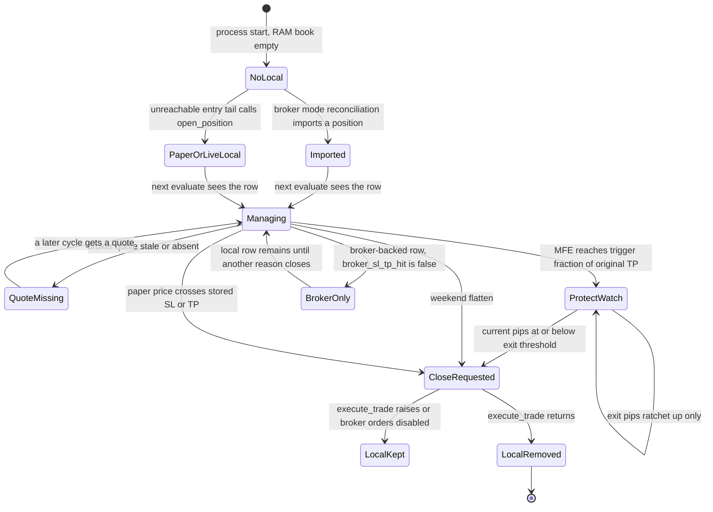

# R.66 Stop-management audit

Source review only. No stop was submitted or modified at a broker.

## Lifecycle

There is no application loop that modifies a broker stop order. Trailing behaviour is an application decision to market-close, not a broker trailing-stop amend. `oanda_exec` attaches `stopLossOnFill` and `takeProfitOnFill` only inside `_place_market_order_open_sync` (`oanda_exec.py` 479–501). That function is not reached by the current producer.

## Initial stop and target

`sl_tp_distance_for_entry` (`trading.py` 119–135):

- `USE_ATR_STOPS` defaults false.
- When it is true and ATR is positive, stop distance is `SL_ATR_MULT` (default 2) times ATR price, optionally floored by `MIN_STOP_DISTANCE_PRICE`.
- Otherwise the stop is `SL_FALLBACK_PIPS` (default 20) times pip size. Pip size is 0.01 when the quote currency is JPY and 0.0001 otherwise (`profit_protection.py` 73–80). Target distance is twice the stop (`TP_RISK_REWARD = 2`).
- ATR here is price, not pips. The conversion to pips happens later in profit protection via `atr_to_pips`.

For a new order the unreachable tail sets, after a simulated or mid fill (`bot_loop.py` 1845–1850):

- BUY: stop = entry − distance, target = entry + distance.
- SELL: stop = entry + distance, target = entry − distance.

That orientation matches a protective stop. `entry_geometry.orientation_valid` requires BUY `sl < reference < tp` and SELL `tp < reference < sl` (`entry_geometry.py` 230–236). `construct_absolute_sl_tp` uses the same signs (`entry_geometry.py` 205–217). The legacy helper `m5_anchored_sl_tp` is the same arithmetic around the M5 mid and is marked in the docstring as the defective live attach because it ignores the executable bid or ask (`entry_geometry.py` 220–227). The broker branch of the unreachable tail replaces that with `resolve_live_entry_geometry` on a fresh quote (`bot_loop.py` 1636–1690) before the early `return` that skips OrderCreate. The geometry function is therefore not what a running cycle uses.

`resolve_broker_manage_price` uses closeout bid for a long and closeout ask for a short (`live_manage.py` 33–38). That is the executable side for a flatten. Paper management uses the M5 mid close, so a paper long can remain open while the bar low traded through the stop, if the close came back (`bot_loop.py` 876–880). See `R66-09`.

## Profit protection

Defaults (`profit_protection.py` 32–66): enabled, trigger at 0.67 of the original target distance, ATR giveback multiplier 0.5, giveback clamped between 0.5 and 30 pips, retry cooldown 30 seconds.

`unrealized_profit_pips` (`profit_protection.py` 83–100): BUY is `(price - entry) / pip`. SELL is `(entry - price) / pip`. The sign is consistent. It does not use the bid/ask spread except through whichever price the caller passes.

`update_protected_exit_pips` (`profit_protection.py` 265–280) stores `max(previous, MFE - giveback)`. The threshold moves only toward more locked-in profit. It does not move in the direction that gives back more than the previous threshold. A negative candidate is possible if giveback exceeds MFE; the max with a previous positive value holds the previous value. The first store can be negative if MFE is below giveback, and `should_close` is `current <= threshold` (`profit_protection.py` 686). Activation requires MFE to meet the trigger first (`mfe_meets_activation`), so a fresh position with a valid target does not arm at once unless reconstructed MFE is already large.

`apply_profit_protection` never decreases `max_profit_pips` (`profit_protection.py` 650–655).

Broker-backed management passes `include_partial_entry_bar=False` into the MFE seed (`bot_loop.py` 832–837). `import_position_from_broker` sets `profit_protection_seeded=True` immediately (`positions.py` 215). The next `seed_position_mfe` returns without reading candles (`profit_protection.py` 524–526). An imported position therefore starts MFE at 0 and learns the peak only from later management prices, not from the high or low since the broker fill. Protection can arm late. It does not invent a peak. See `R66-06`.

This ratchet is not written to the broker. If the process stops, the broker keeps only the stop and target that were on the trade when it was opened or imported. A local threshold disappears with the RAM book.

## Broker hard stop versus local state

`broker_sl_tp_hit` returns false and ignores the position (`live_manage.py` 76–78). The comment says OANDA is authoritative for hard SL/TP. The application will not market-close a broker-backed row because local price crossed `pos.stop_loss` or `pos.take_profit`.

That is safe when the broker trade actually has a stop. Reconciliation import does not create one. `_import_broker_truth` (`reconciliation.py` 454–516) prefers trade or pending SL/TP. If either is missing it fills from `sl_tp_distance_for_entry` and labels the source `local_fallback`. The fallback prices are stored on the local `Position`. They are not sent as an OrderCreate or a trade amend. Combined with `broker_sl_tp_hit` returning false, a broker position imported without a broker stop has no application hard stop and no new broker stop. Weekend flatten and, after the trigger, profit protection can still market-close it. Until one of those fires, the position is unprotected by this process. See `R66-03` and `R66-05`.

A local record of a stop is not evidence the broker has that stop. `sl_source` can be `local_fallback`.

## Close, rejection, and restart

`execute_trade` for kind `live` calls `PositionClose` and raises if broker orders are disabled or the close fails (`trading.py` 391–398, `oanda_exec.py` 397–450). `_evaluate_impl` removes the local row only after that call returns (`bot_loop.py` 1058–1084). A timeout string is classified `PROTECTIVE_CLOSE_UNCONFIRMED` and the local row stays.

The close request does not read back the filled unit count before `close_position`. A response that returns without raising drops the entire local row even if the broker left a residual. The next broker-mode reconcile can import the residual again (`reconciliation.py` 638–650). See `R66-10`.

`PositionClose` is a market flatten of the requested units (`longUnits` for BUY, `shortUnits` for SELL). It is not a stop amend. A lost response followed by another cycle can send a second PositionClose. The default `RECONCILE_ACTION` is `log_only` (`reconciliation.py` 82–84), so a broker-flat book does not by itself delete the local row. The local row can keep requesting closes. See `R66-11`.

Positions are not restored from PostgreSQL at startup. `recover_orders` loads orders and reconcile metadata (`app.py` 574–579). After a restart the RAM book is empty until reconciliation imports. In paper mode, import is off unless `RECONCILE_IMPORT_BROKER_POSITIONS` is set. A broker stop that already exists at OANDA remains at OANDA across the restart. An application trailing threshold does not.

Minimum hold (`_min_position_hold_sec`) can delay a paper SL/TP close. It does not delay weekend flatten or profit protection. Broker hard stops are not polled, so the hold does not delay an OANDA-side stop fill. It also cannot replace a missing broker stop.

Spread: geometry checks clearance on the unreachable entry path (`entry_geometry.py` 128–159). Management uses closeout prices, which already include the broker's closeout side. Profit-protection pips do not subtract spread again. A long marked on closeout bid is the conservative side for a flatten. A paper long marked on mid is not.

Instrument minimum stop distance from the broker is not applied in `sl_tp_distance_for_entry`. A 20-pip fallback can be inside a broker minimum. That rejection cannot occur on the current cycle because OrderCreate is not reached. If a later change enables the open, the rejection path is `OrderCreateRejected` in the dead tail, which does not attach a position (`bot_loop.py` 1717–1726), but that handler is itself unreachable behind the early return.
