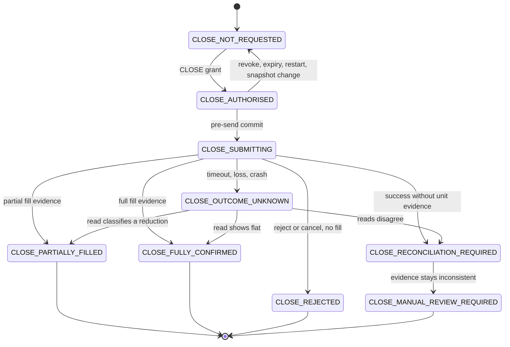

# R.67B Close lifecycle

Design only. A close operation is not a RAM position. Production entries stay blocked. No close is sent by this stage. `REAL_NETWORK_EXECUTION_NOT_TESTED`. Production trading remains NO-GO.

## Identity of one close

`close_operation_id` is minted by the bot when a `CLOSE` grant is accepted. It is the R.67A `attempt_id` and the `pending_close_id`. It is not `positions` dict key, not `local_tracking_id`, and not a broker trade id.

The operation names one account, one instrument, one `book_side`, the trade ids on the grant, a unit count not greater than `broker_units`, the endpoint `PositionClose`, and the `snapshot_id` it was authorised against. A `PositionClose` operation does not authorise `TradeClose` (`R67A`).

Current sender: `_place_market_order_sync` builds `PositionCloseRequest` with `longUnits` or `shortUnits` only and returns P&L and price (`oanda_exec.py` 397–450, `R66-10`, `R66-11`). Any exception becomes `RuntimeError` (`431–433`). The caller then removes the whole local row only when that call returns (`bot_loop.py` 1058–1084). On exception it keeps the row and returns (`1073–1083`), so the next manage cycle can submit again.

## Installed client request model

Read from local package source. No request was sent.

| Fact | Evidence | Classification |
| --- | --- | --- |
| Endpoint | `PUT v3/accounts/{accountID}/positions/{instrument}/close` in `oandapyV20/endpoints/positions.py` | Present on the client. Live behaviour `NOT_VERIFIED`. |
| Body fields | `PositionCloseRequest` accepts `longUnits`, `shortUnits`, optional `longClientExtensions`, optional `shortClientExtensions` | No separate request-id or idempotency-key parameter. |
| Client extension shape | `ClientExtensions` writes `id`, `tag`, and `comment`, each a non-empty string of at most 128 characters | Optional correlation fields. The bot does not set them. |
| Sample close body | Installed response sample uses `"longUnits": "ALL"` | `Units` accepts an integer string or a one- or two-decimal string. It rejects `ALL`. This design forbids `ALL` because it hides the quantity. Whether the host accepts `ALL` is `NOT_VERIFIED`. |
| Sample success body | `longOrderFillTransaction.units` and `tradesClosed[]` with `tradeID` and `units` | Shape exists in the package sample. The bot parser discards it. Whether every live success body contains it is `NOT_VERIFIED`. |
| Sample echo | That sample has no `clientExtensions` field | Echo of extensions on a fill is `NOT_VERIFIED`. |
| Server-side idempotency of `PositionClose` | No field, header, or sample in the installed client says a repeated `PositionClose` is deduplicated | `NOT_AVAILABLE_IN_INSTALLED_CLIENT`. Do not assume it. |

`OrderCreate` classification (`oanda_exec.py` 210–316) treats a usable fill as filled, a cancel without a fill as cancelled, and timeouts plus HTTP 408 and 5xx as `AMBIGUOUS_TRANSPORT`. That classifier is for open orders. This design copies only those evidence distinctions. It does not claim the classifier runs on `PositionClose` today.

Market-order `clientExtensions.id` is a different endpoint. Uniqueness behaviour for order client ids is not evidence that `PositionClose` is idempotent.

## Conservative retry rule

Native idempotency is not available from the installed client. The policy is reconciliation before any later close, and a timeout does not start that later close.

A repeated `PositionClose` is forbidden when any operation for that account, instrument, and book side is in `CLOSE_SUBMITTING`, `CLOSE_OUTCOME_UNKNOWN`, `CLOSE_RECONCILIATION_REQUIRED`, or `CLOSE_MANUAL_REVIEW_REQUIRED`. Elapsed time is not a trigger. A new operation id requires a new `CLOSE` grant, a new snapshot match, and a prior operation that has already classified the units (`CLOSE_REJECTED` with a later read showing those units still open, or `CLOSE_PARTIALLY_FILLED` with the remainder recorded from a read). `CLOSE_OUTCOME_UNKNOWN` never satisfies that predecessor condition.

## States

| State | Meaning |
| --- | --- |
| `CLOSE_NOT_REQUESTED` | No grant and no durable operation. |
| `CLOSE_AUTHORISED` | One `CLOSE` grant is recorded and not yet consumed. Nothing has been sent. |
| `CLOSE_SUBMITTING` | The pre-send commit succeeded. This process may attempt one HTTP call. The grant is consumed. |
| `CLOSE_OUTCOME_UNKNOWN` | Bytes may have left the process, or the response was not classified. Not a rejection and not a fill. |
| `CLOSE_PARTIALLY_FILLED` | Broker evidence shows closed units greater than zero and smaller than the granted units. Remainder stays. |
| `CLOSE_FULLY_CONFIRMED` | Fill evidence covers the granted units, or a later read shows the side flat with closing transactions covering those units. |
| `CLOSE_REJECTED` | Broker evidence says this attempt was rejected or cancelled and no fill is present. Exposure is unchanged only after a confirming read. |
| `CLOSE_RECONCILIATION_REQUIRED` | A response or a pair of reads is insufficient or inconsistent. No resend. |
| `CLOSE_MANUAL_REVIEW_REQUIRED` | Complete evidence disagrees with itself. A person classifies it outside the bot. The bot still does not resend. |

There is no edge from `CLOSE_OUTCOME_UNKNOWN` back to `CLOSE_SUBMITTING`.

## Sufficient fill evidence

All of these are required before `CLOSE_FULLY_CONFIRMED` from an HTTP body:

- The body is a dict.
- The side's fill transaction is present (`longOrderFillTransaction` or `shortOrderFillTransaction`).
- `units` on that fill parses to a finite absolute quantity equal to the granted units.
- `tradesClosed` is a list. Each element has `tradeID` and `units`.
- The absolute sum of `tradesClosed` units equals the fill units.
- Every `tradeID` was on the grant.
- A cancel or reject transaction is absent, or a fill is present and wins. A cancel alone is not a full close.

Anything less, including the current parser's price and P&L (`oanda_exec.py` 446–450), is not a full close. It is `CLOSE_RECONCILIATION_REQUIRED` when the HTTP call returned a body, and `CLOSE_OUTCOME_UNKNOWN` when it did not.

Partial evidence is the same list with the summed units greater than zero and less than the granted units. The parent observation keeps the unreduced trade ids until a later read lists them. Local units change only from that read (`R67A` partial-reduction rule).

A timeout, a connection error, HTTP 408, or an exception whose type or text is timeout-like (`oanda_exec.py` 272–286) is `CLOSE_OUTCOME_UNKNOWN`. It is not `CLOSE_REJECTED` and not `CLOSE_FULLY_CONFIRMED`.

## Transitions

Each row is one durable transition. Retry permission is for this same `close_operation_id`. Failure outcome is what remains if the trigger cannot be recorded.

| Transition | Trigger | Authority | Broker evidence | Local state change | Retry | Failure outcome | Persistence |
| --- | --- | --- | --- | --- | --- | --- | --- |
| `CLOSE_NOT_REQUESTED` to `CLOSE_AUTHORISED` | Operator `CLOSE` grant, or a future bot-create ceremony attached to a fill this bot submitted. Import and `log_only` are not triggers (`R66-04`). | New `CLOSE` grant matching identity, units, snapshot, expiry. | None yet. | Create the operation. Set `pending_close_id`. Do not send. | No | Stay `CLOSE_NOT_REQUESTED`. Do not send. | Commit the operation and the grant before any later step. |
| `CLOSE_AUTHORISED` to `CLOSE_NOT_REQUESTED` | Expiry, operator revoke, snapshot id change, or process start. | Grant becomes invalid. Restart clears effective execution authority (`R67A` invariant 10). | None. | Clear `pending_close_id`. Observation unchanged. | No | Leave the grant unusable. | Commit the revocation. A lost commit means the next process still refuses to send, because execution authority does not reload. |
| `CLOSE_AUTHORISED` to `CLOSE_SUBMITTING` | The single-flight check finds no other open close for that side, and the grant still matches the snapshot. | The same `CLOSE` grant, consumed by this commit. | None yet. | `pending_close_id` remains. Provenance becomes `CLOSE_AMBIGUOUS` at this commit, before bytes (`R67A`). | No | If the commit fails, stay `CLOSE_AUTHORISED` and do not call the network. | This commit is the pre-send record. It must complete before the HTTP call. |
| `CLOSE_SUBMITTING` to `CLOSE_OUTCOME_UNKNOWN` | Timeout, connection loss, HTTP 408, 5xx, empty body, crash recovery of `CLOSE_SUBMITTING`, or an exception that is not a classified reject. | Grant already consumed. No new authority. | Absent or unusable. | Units unchanged. Observation not flat. | No. Time elapsed does not add permission (`R66-11`). | Remain `CLOSE_OUTCOME_UNKNOWN`. | Commit the unknown state as soon as the call returns or the process recovers. |
| `CLOSE_SUBMITTING` to `CLOSE_PARTIALLY_FILLED` | HTTP body meets the partial-evidence rule. | Grant already consumed. | Fill units and `tradesClosed` sum to a positive shortfall. | Record a `PARTIAL_REDUCTION` child. Do not delete the parent. Do not set the remainder from arithmetic alone. | No on this id. A later close of the remainder needs a new grant after a read. | If the body cannot be stored, `CLOSE_OUTCOME_UNKNOWN`. | Commit the child and the new state together. |
| `CLOSE_SUBMITTING` to `CLOSE_FULLY_CONFIRMED` | HTTP body meets the full-evidence rule, or a later read meets the flat rule for every granted trade. | Grant already consumed. | Fill sum equals granted units, or trade state `CLOSED` plus closing transaction ids and zero `currentUnits`. | Close operation complete. Observation becomes `BROKER_FLAT_CONFIRMED` only from the read, not from the fill alone. RAM `close_position` is not this transition (`bot_loop.py` 1084, `R66-10`). | No | Insufficient evidence goes to `CLOSE_RECONCILIATION_REQUIRED` or stays unknown. | Commit fill transaction ids and per-trade units with the state. |
| `CLOSE_SUBMITTING` to `CLOSE_REJECTED` | Classified reject: HTTP 400–499 except 408, with no fill transaction, or a cancel transaction and no fill transaction. | Grant already consumed. | Reject or cancel payload. A fill anywhere in the body wins and this transition is forbidden. | Attempt ended. Units unchanged only after a later read agrees. Until that read, reconciliation state is not flat and a new grant is withheld. | No on this id. | Ambiguous HTTP stays unknown. | Commit the reject or cancel transaction id. |
| `CLOSE_SUBMITTING` to `CLOSE_RECONCILIATION_REQUIRED` | HTTP success whose body lacks the unit evidence above. Price and P&L alone are this case. | Grant already consumed. | Body present, unit evidence absent. | Do not retire the observation. Do not mark flat. | No | If the body cannot be stored, `CLOSE_OUTCOME_UNKNOWN`. | Commit the raw classification as insufficient, not as a fill. |
| `CLOSE_OUTCOME_UNKNOWN` to `CLOSE_PARTIALLY_FILLED` | A complete trade or transaction read shows a reduction tied to this attempt's trade ids, with closed units below the grant. | None. Resolution does not mint a grant (`R67A`). | `TradeDetails` and, where the trade is closed, the closing transaction (`broker_exit.py` 176–202). | `PARTIAL_REDUCTION` child. Remainder preserved. | No | Failed read stays unknown. | Commit the read's snapshot id with the child. |
| `CLOSE_OUTCOME_UNKNOWN` to `CLOSE_FULLY_CONFIRMED` | Read shows each granted trade closed, or the side at zero, with closing transaction ids, and closed units cover the grant. | None. | Same read bar as `BROKER_FLAT_CONFIRMED`. | Operation complete. Retirement of the local record still follows the reconciliation rule. | No | A read that fails or is incomplete stays unknown. Omission from a failed OpenPositions is not this trigger. | Commit transaction ids before the observation is marked flat. |
| `CLOSE_OUTCOME_UNKNOWN` to `CLOSE_RECONCILIATION_REQUIRED` | Two complete reads disagree, or a stored body and a later read disagree. | None. | Conflicting complete evidence. | No unit overwrite. No resend. | No | A single failed read does not enter this state. It stays unknown. | Commit both snapshot ids. |
| `CLOSE_RECONCILIATION_REQUIRED` to `CLOSE_PARTIALLY_FILLED`, `CLOSE_FULLY_CONFIRMED`, or `CLOSE_REJECTED` | A later complete read fits exactly one of those evidence rules. | None. | That read. | Matching local child or flat observation. | No | If the read does not fit one rule, stay here. | Commit the resolving snapshot. |
| `CLOSE_RECONCILIATION_REQUIRED` to `CLOSE_MANUAL_REVIEW_REQUIRED` | Further complete reads remain inconsistent. | None. An operator record may classify later. The bot does not send because of that record. | The conflicting snapshots already stored. | Flag for a person. Broker controls stay available. | No | Stay in reconciliation if the conflict flag cannot be stored. | Commit the review flag. It is not a `CLOSE` grant. |
| `CLOSE_PARTIALLY_FILLED` remains | Any later manage cycle, timeout, or restart. | None on this id. | The partial evidence already stored. | Remainder stays an open observation. Protection is re-read per remaining trade. | No | Losing the child record moves the operation back to `CLOSE_RECONCILIATION_REQUIRED` on recovery, not to a resend. | The partial row is durable. |
| `CLOSE_FULLY_CONFIRMED`, `CLOSE_REJECTED`, `CLOSE_MANUAL_REVIEW_REQUIRED` remain | Restart or another loop. | Execution authority does not reload. | Already stored. | No new send from the stored row. | No | A row that cannot be read leaves the side blocked from a new close until the store is readable again. | These rows are history. History is not permission. |

`CLOSE_AUTHORISED` is the only state in which a process may still choose not to send. After `CLOSE_SUBMITTING` is committed, the only legal network action is the one attempt already authorised, and recovery from a crash treats that attempt as already spent.

## Crash windows

| Window | What is durable | Recovery | Send again |
| --- | --- | --- | --- |
| Before submission | `CLOSE_NOT_REQUESTED`, or `CLOSE_AUTHORISED` with no pre-send commit | Restart revokes `CLOSE_AUTHORISED`. No bytes were permitted. | Only a new grant in the new process, and only if no unknown operation exists. |
| During submission | `CLOSE_SUBMITTING` committed; HTTP may or may not have started | Load as `CLOSE_OUTCOME_UNKNOWN`. Provenance `CLOSE_AMBIGUOUS`. | No. |
| After broker acceptance, before local acknowledgement | Broker may hold a fill the process did not commit | `CLOSE_OUTCOME_UNKNOWN` until a read classifies units. A price log line is not acknowledgement. | No. |
| After partial fill | Partial child committed, or not | If committed, `CLOSE_PARTIALLY_FILLED` and the remainder stays. If not committed, unknown, and the read reconstructs the child. | No, until a new grant targets only the read remainder. |
| After full fill, before persistence | Fill may exist only at the broker | Unknown until the read shows flat with closing transactions. Do not call `close_position` from memory. | No. |
| During reconciliation | Observation epoch may be mid-update; close row is already unknown, partial, or reconciliation-required | Reconcile may refresh observation. It must not clear `pending_close_id` and must not grant. | No. |
| During restart recovery | Execution authority empty. Close rows in submitting, unknown, reconciliation, or manual review are reloaded as non-sendable | `MONITOR` is not effective until a new snapshot rematch. Protection reloads as `PROTECTION_STALE` or `PROTECTION_UNKNOWN` per R.67A. | No. |

## Human control

Nothing in this lifecycle disables the account or rejects an external client. A person may close or reduce the position in the broker's own tools while the bot is in `CLOSE_OUTCOME_UNKNOWN`. The bot records the later read and does not send a competing close. An emergency flatten by the bot is still a new `CLOSE` grant, and it is forbidden while an operation is unresolved. Absence of a grant fails closed inside the bot (`R67A` human-control rule).

## Unresolved broker semantics

- Whether the practice or live host deduplicates `PositionClose`: `NOT_VERIFIED`, and not claimed.
- Whether `longClientExtensions.id` is echoed on `longOrderFillTransaction`: `NOT_VERIFIED`. A missing echo is neither success nor failure.
- How `PositionClose` allocates a partial unit count across several trade ids: `NOT_VERIFIED`. The sample shows `tradesClosed` listing more than one trade. This design trusts that list when it is present and refuses to guess when it is absent.
- Whether decimal unit strings are accepted: the installed `Units` type allows one or two decimal places. Host acceptance is `NOT_VERIFIED`.
- `TradeClose` remains unused. This lifecycle does not switch the sender to it.
