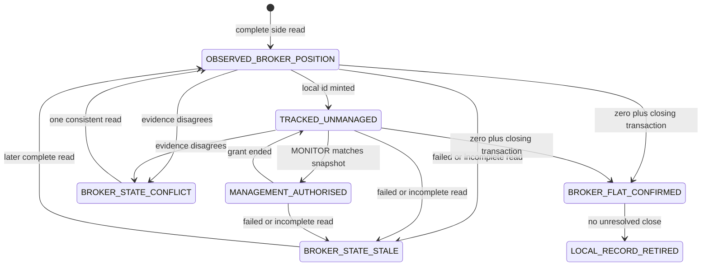

# R.67B Reconciliation state machine

Design only. R.67A is the ownership, authority, and protection contract. This document adds reconciliation states. It does not change operational Python. `REAL_NETWORK_EXECUTION_NOT_TESTED`. Production trading remains NO-GO.

## R.67A review

The five R.67A documents were read before this design. They are complete for this stage: observation, management, and execution authority stay separate; an import is observation only; a local fallback price is not broker protection; a full close needs broker evidence; an ambiguous close blocks another close; restart does not restore execution authority.

No contradiction in those documents blocks a state machine. Two names are mapped, not redefined:

- R.67A provenance `CLOSE_AMBIGUOUS` is the ownership label. The close lifecycle in `R67B_CLOSE_LIFECYCLE.md` uses `CLOSE_OUTCOME_UNKNOWN`, `CLOSE_SUBMITTING` recovered after a crash, and `CLOSE_RECONCILIATION_REQUIRED`.
- R.67A `OBSERVED_FLAT` and this document's `BROKER_FLAT_CONFIRMED` use the same evidence: a fresh read of the targeted side at zero units, plus a closing transaction id when the previous read had units.

The user designated R.67A as the approved starting contract for this stage. This review is a consistency check of those five files against the working tree, performed in the same design thread.

## Source boundary

Commit `d080d897945bc44fa37c02caab504ed707146bec`. These hashes match `R67A_SECURITY_REVIEW.md`. `CHANGED []`.

| Path | SHA-256 |
| --- | --- |
| `forex_bot/bot_loop.py` | `6e953f7a2b0aa93f1f65c7b411d117e74cba6adf523f8514847bc69a7ea5c796` |
| `forex_bot/live_manage.py` | `60d87b8665620743467832758032857e975d32da15322307a0c331009cc7b25d` |
| `forex_bot/reconciliation.py` | `295686792ab017cfc8dfba8fd0add6b2b66a3008304ade141e899af7e86e776b` |
| `forex_bot/oanda_exec.py` | `f4beb250d81852d8ee4f22af06ab33194c6b4ba1bf6f9b1a6b5d11d3b7b265c8` |
| `forex_bot/positions.py` | `e63ac07e6677ae5707a2a75888bcd5c39df5957ab34547659546e8546d537f2a` |
| `forex_bot/execution.py` | `6602e363171e3aac4bc4b597ddb805c454c7ca40f7d1fe3fddf542f6a1ab86e2` |
| `forex_bot/trading.py` | `5ac3981690fe9536edaedfd35a933d17fc37a1e4a77c5c3e9b47517db6300fc7` |
| `forex_bot/app.py` | `1883d3c94a570b66782b7079bcd64d7657c83c0cd6faa385cab7a65bc2d56bd1` |
| `main.py` | `4711818ad85b12d1be94e13a08182ff60881416302a84a573fe18f37a043d3eb` |

`forex_bot/broker_exit.py` is `d9920eed6160c5f26e1db7ee34095488b3457755e5dbf21cffbeda08eb798c12`. `forex_bot/database.py` is `be83fc2a485af0f392203562a8286082587b0824f235557b6036e69f661f840d`. Those two were read for this design and were not part of the R.67A eight-file set.

The production entry path stays blocked (`bot_loop.py` 3323–3328 and 1125–1134, `R66-01`).

## What a reconciliation state describes

A state belongs to one observation identity from R.67A: `account_id`, `instrument`, `book_side`, and the `trade_ids` on that side. It is not a symbol key in `positions` (`positions.py` 8–9, `R66-16`).

`log_only` is the source default (`reconciliation.py` 82–84). In this design `log_only` may write observation fields only. It must not enter `MANAGEMENT_AUTHORISED` and must not create a `CLOSE` grant. `RECONCILE_ACTION=auto_fix` is also not authority (`R67A` invariant 9). The current import under broker mode (`reconciliation.py` 530, 638–650, `R66-04`) is a forbidden transition that this design does not keep.

## States

| State | Meaning |
| --- | --- |
| `OBSERVED_BROKER_POSITION` | A complete broker read showed this side with units. Management is false. Execution authority is false. |
| `TRACKED_UNMANAGED` | The bot has a `local_tracking_id` for that observation. No `MONITOR` grant is effective. |
| `MANAGEMENT_AUTHORISED` | A `MONITOR` grant matches this identity and the current `snapshot_id`. Execution authority stays false. |
| `BROKER_STATE_STALE` | The last complete snapshot is outside `BROKER_SNAPSHOT_FRESHNESS`, or the latest read failed or was incomplete. Prior units remain. Absence in that read is not flat. |
| `BROKER_STATE_CONFLICT` | Two complete pieces of evidence disagree. No side is retired and no close is sent. |
| `BROKER_FLAT_CONFIRMED` | Fresh read shows the targeted side at zero, and a closing transaction id exists when the previous complete read had units. Same bar as R.67A `OBSERVED_FLAT`. |
| `LOCAL_RECORD_RETIRED` | The observation archive is closed after `BROKER_FLAT_CONFIRMED`, and no close operation is unresolved. This is not a RAM delete and not a claim that the bot closed the position. |

`BROKER_SNAPSHOT_FRESHNESS` is an unnamed symbol, like R.67A `PROTECTION_FRESHNESS`. This design does not set a number and does not change a trading parameter.

## Complete snapshot

A read is complete only when all of these hold:

- The call returns a dict. A timeout, connection error, or exception is incomplete (`reconciliation.py` 737–741 raises into `err` and does not replace the snapshot).
- The OpenPositions body contains a `positions` array. A missing key is incomplete. An empty array is a complete account-level result and still does not, by itself, retire a previously seen side.
- Each position object used for this identity has parseable `long` and `short` unit fields. A parse failure on the relevant instrument makes that instrument incomplete.
- `account_id` and `instrument` are present.

`fetch_broker_positions_detail` today raises when the client or account id is missing in broker mode (`reconciliation.py` 226–233) and raises on request failure (`242–244`). That refusal to treat failure as an empty book is the behaviour this design keeps. On success it stores nets only (`325–328`) and, when a local symbol is absent from that dict, the mismatch text says broker net is 0 (`771–774`). This design does not treat that omission as `BROKER_FLAT_CONFIRMED`.

A successful empty `positions` array advances the reconciliation epoch. It does not set `BROKER_FLAT_CONFIRMED` for a side that previously had units until `TradeDetails` for each prior trade id is `CLOSED`, `currentUnits` is zero, and a closing transaction id is present. That is the evidence `broker_exit.resolve_broker_exit` already requires before it will call a lookup ok (`broker_exit.py` 176–202). A live payload was not fetched. Whether every closed trade carries those fields is `NOT_VERIFIED`. Missing fields stay unresolved.

## Reconciliation epoch

Each complete OpenPositions parse commits a new monotonic `reconcile_epoch` and a new `snapshot_id` (time, endpoint name, hash of account, instrument, side, trade ids, and units). A failed or incomplete read does not increment the epoch and does not replace the previous snapshot. Callers keep the previous observation and move that identity to `BROKER_STATE_STALE` when the previous snapshot is no longer inside `BROKER_SNAPSHOT_FRESHNESS` or the failure is the latest attempt.

## Transitions

| Event | From | To | Rule |
| --- | --- | --- | --- |
| Broker position discovered | No record | `OBSERVED_BROKER_POSITION` | Complete read, one side, units nonzero, trade ids copied from that side. Provenance `EXTERNAL_UNKNOWN` unless a recorded bot fill matches. Management false. Execution false. `R66-04`, `R67A` import default. |
| Same position seen again | `OBSERVED_BROKER_POSITION` or `TRACKED_UNMANAGED` | Same state | Newer complete snapshot, same trade ids, same units. Authority flags stay false. |
| Local tracking id minted | `OBSERVED_BROKER_POSITION` | `TRACKED_UNMANAGED` | Id is bot-minted. It is not a trade id and not a grant. |
| Explicit monitor | `TRACKED_UNMANAGED` | `MANAGEMENT_AUTHORISED` | `MONITOR` grant matches account, instrument, book side, trade ids, and `snapshot_id`, and it is unexpired and unrevoked. `log_only` cannot do this. |
| Broker position missing from a complete account read | Any open observation | Unchanged, then a trade read | Omission starts resolution. `BROKER_FLAT_CONFIRMED` only after the closing-transaction bar. Until then the prior units remain. |
| Broker position missing from a failed or incomplete read | Any open observation | `BROKER_STATE_STALE` | Do not change units. Do not retire. Do not import. Do not close. |
| Broker API timeout | Any open observation | `BROKER_STATE_STALE` | Timeout is not a snapshot. Same prohibition as a failed read. |
| Position size changed on a complete read, no close pending | `OBSERVED_BROKER_POSITION` or `TRACKED_UNMANAGED` | Same state | Replace `broker_units` only from that read. If a `MONITOR` grant named the old `snapshot_id`, it is no longer effective and the state is `TRACKED_UNMANAGED`. |
| Position manually closed at the broker | Open observation | `BROKER_FLAT_CONFIRMED` | Same evidence as any other flat side. Provenance does not become `BOT_CREATED`. The bot does not claim the close. |
| Position partially reduced | Open observation | Same open state plus a `PARTIAL_REDUCTION` child | Trade ids still listed remain the identity. Local units change only after the read. Parent is not deleted (`R66-10`). |
| Multiple trades on one instrument side | Discovery | One observation per trade id | The side aggregate is not a management identity. Instrument confidence is the worst protection state (`R67A`). |
| Both long and short units nonzero | Discovery | Two observations | Management of that instrument is forbidden (`R67A`). This is not flattened into one net (`reconciliation.py` 270–279). Hedging permission on the account is `NOT_VERIFIED`. |
| Reconciliation while a close is pending | Any | Observation fields may update | `pending_close_id` stays. No new grant. No second close. No `LOCAL_RECORD_RETIRED` until the close operation is classified and flat is confirmed. |
| Reconciliation while management is running | `MANAGEMENT_AUTHORISED` | `TRACKED_UNMANAGED` if `snapshot_id` changes | Reconcile does not write grants (`R66-16`). A close request drafted against the old snapshot is dropped. It is not sent. |
| Process restart | Any durable observation | `TRACKED_UNMANAGED` or `OBSERVED_BROKER_POSITION`, never `MANAGEMENT_AUTHORISED`, until a fresh in-process snapshot rematches a stored `MONITOR` grant | Execution authority loads empty (`R67A` invariant 10). A `CLOSE_AUTHORISED` operation that never reached the pre-send commit is revoked. |

`LOCAL_RECORD_RETIRED` is allowed only from `BROKER_FLAT_CONFIRMED` when every close operation for that identity is `CLOSE_FULLY_CONFIRMED`, `CLOSE_REJECTED` with a later read that still shows zero, or there was never a close operation. An unresolved close blocks retirement.

Paper rows (`execution_kind` in `paper`, `simulated`, `window_paper`) are not broker observations. A Case B displace (`reconciliation.py` 537–560) must not turn the replacement into `MANAGEMENT_AUTHORISED`.

## Protection held on the observation

Protection fields stay the R.67A fields. Reconciliation may replace them only from a trade read in this process. It must not copy `local_stop_reference` into `confirmed_broker_stop_price`.

| Situation | Protection state after the reconciliation rule | Close or stop action |
| --- | --- | --- |
| Broker stop present | `BROKER_PROTECTED` only when this process has a `TradeDetails` read with stop order id, finite price, and that trade id, inside `PROTECTION_FRESHNESS`. The current parser stores price only (`reconciliation.py` 375–388), so today's source cannot enter this state. | No amendment. |
| Broker stop missing | `UNPROTECTED_CONFIRMED` only when that trade read succeeded and the stop field is null or absent. | No protective order is sent. |
| Local fallback present | `LOCAL_REFERENCE_ONLY`. The 20-pip path (`reconciliation.py` 491–498, `R66-05`) stays in this state. | No label of `BROKER_PROTECTED`. `broker_sl_tp_hit` remains a non-proof (`live_manage.py` 76–78, `R66-03`). |
| Stop cancelled manually | Next complete trade read with a null stop enters `UNPROTECTED_CONFIRMED`. A failed read enters `PROTECTION_UNKNOWN` and the observation becomes `BROKER_STATE_STALE` or stays open with unknown protection. The old id is not current proof. | No replacement stop. |
| Broker snapshot stale | `PROTECTION_STALE` if a prior verification record exists, otherwise `PROTECTION_UNKNOWN`. Observation state `BROKER_STATE_STALE`. | Do not manage from it and do not close from it. |
| Stop amendment rejected | Not a transition this design can cause, because no amendment is sent. If a human's amendment is visible only as a disagreed order id on the next trade read, protection becomes `PROTECTION_STALE` until a read repeats one id and price together. | No retry of an amendment. |
| Broker position partially reduced | Protection is re-read per remaining trade id. Unknown on any remaining id makes the side unknown. Reduced-away trades follow the flat evidence rule and do not leave their stop price behind as protection for the remainder. | Remaining units stay. No automatic close of the rest. |
| Position fully closed | Protection is irrelevant once `BROKER_FLAT_CONFIRMED` is reached. A leftover local price must not keep the row looking protected. | Retirement still waits for the close-operation rule above. |
| Restart with missing local protection state | No verification record: `PROTECTION_UNKNOWN`. A price-only future row: `LOCAL_REFERENCE_ONLY` or `PROTECTION_UNKNOWN`, never `BROKER_PROTECTED`, until a new trade read supplies the order id (`R67A` restart rule). | No stop is attached to fill the gap. |

Worst-of aggregation from R.67A still applies: `PROTECTION_UNKNOWN`, then `PROTECTION_STALE`, then `LOCAL_REFERENCE_ONLY`, then `UNPROTECTED_CONFIRMED`, then `BROKER_PROTECTED`.

## What this machine refuses

- `log_only`, `auto_fix`, `execution_kind`, and a trade id do not enter `MANAGEMENT_AUTHORISED`.
- A failed, timed out, or incomplete snapshot does not enter `BROKER_FLAT_CONFIRMED`.
- Reconciliation does not send `PositionClose` and does not send a stop.
- The entry path stays blocked. Discovery of a broker position is not an entry signal (`R67A` source mapping).
